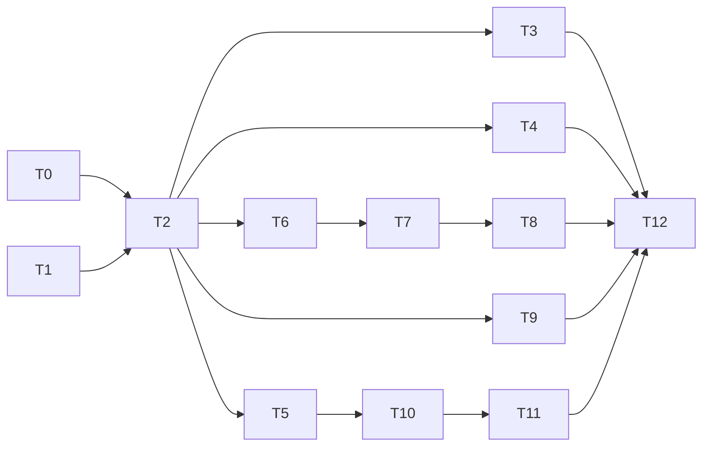

# Inscrição: kit opcional, evento gratuito, taxa, lotes×categorias e comprovante

> Branch: `fix/2` · Tipo: **WEB + BACKEND (full-stack)** · Modo: PLANEJAMENTO (nenhum código escrito)
> Agentes: `backend-specialist` (API/Worker/DB) + `frontend-specialist` (Astro/React) · Skills: `database-design`, `api-patterns`, `tdd-workflow`, `testing-patterns`, `clean-code`

## 1. Overview

Cinco mudanças no fluxo de inscrição/criação de evento. Hoje as regras de preço, lote e vaga estão **duplicadas e divergentes** entre `RegistrationForm.tsx`, `registrations.service.ts` e `registration.processor.ts`. A estratégia é criar **uma fonte única de regras** em `packages/shared` (funções puras e testáveis) e fazer front, API e worker consumirem a mesma lógica.

### Decisões aprovadas no Socratic Gate

| # | Decisão |
|---|---------|
| 1 | `Event.hasKit` + lista de tamanhos configurável por evento (`kitSizes`) |
| 3 | Taxa padrão no Tenant, **override opcional por evento**, 0% válido (esconde a linha) |
| 4a | **Batch pertence à Category**; cada lote é por **DATA** *ou* por **QUANTIDADE** |
| 4b | Quantidade do lote **definida manualmente**; soma ≤ vagas da categoria |
| 4c | Coletar **data de nascimento + gênero**; idade calculada **na data do evento**; validar no **backend e front** |
| 5 | **PDF no backend**, download na tela de sucesso e no painel, **anexo no e-mail**, com código/QR de verificação |

### Achados no código atual (viram tarefas ou riscos)

| Achado | Onde | Impacto |
|--------|------|---------|
| `Number(commissionRate \|\| 10)` transforma **0% em 10%** | `inscricao/[eventId].astro` L33 e default `=10` no form | Quebra o item 3 |
| Cupons `RIO10`/`TRAIL20` **fixos no front** | `RegistrationForm.tsx` L168-193 | Cupom real nunca é validado na tela; resumo diverge do cobrado |
| `Category.availableSlots` é **decrementado** a cada venda | `registration.processor.ts` L67 | Não há capacidade original → impossível validar "soma dos lotes ≤ vagas" na edição |
| API **não valida** lote/categoria/idade/data; confia no `batchId` do cliente | `registrations.service.ts` | Item 4 exige validação server-side |
| `findOne` de inscrição **sem checar dono** | `registrations.service.ts` L112 | Comprovante exporia dados de terceiros → precisa de ownership |
| Pagamento sempre enfileirado, mesmo com total 0 | `registration.processor.ts` L138-173 | Item 2: Asaas não aceita cobrança R$ 0 |
| Lote "ativo" = `active: true` apenas; datas ignoradas | `inscricao/[eventId].astro` L20 | Item 4 |

## 2. Success Criteria

- [ ] Evento sem kit: nenhum campo/linha de camiseta no front; API rejeita `shirtSize` quando `hasKit=false`.
- [ ] Total = R$ 0 (lote grátis **ou** cupom 100%): sem cupom/taxa/forma de pagamento na UI, botão "FINALIZAR INSCRIÇÃO", inscrição vai direto a `CONFIRMED` sem tocar no Asaas.
- [ ] Taxa 0% (evento ou tenant) não mostra linha de taxa e não cobra taxa.
- [ ] Lote ativo é **resolvido no servidor** por categoria; cliente não escolhe lote.
- [ ] Atleta fora de idade/gênero da categoria **não consegue se inscrever** (front bloqueia, API devolve 422).
- [ ] Organizador não consegue salvar lotes inconsistentes (datas sobrepostas, 1º lote ≠ abertura, soma de quantidades > vagas).
- [ ] Comprovante PDF baixável por dono/admin, enviado por e-mail, verificável por código.
- [ ] Todo código novo/alterado coberto pelos cenários da **§8** (unit + e2e HTTP), escritos antes do código (TDD).
- [ ] Cobertura **100%** nos 3 pacotes (`api`, `workers`, `shared`), `.env.test`, nenhum teste skipado.

## 3. Modelo de dados (migração Prisma + `rls.sql`)

```diff
 model Event {
+  hasKit              Boolean   @default(false)
+  kitSizes            String[]  @default([])          // ex.: ["P","M","G","GG"]
+  adminFeeRate        Decimal?  @db.Decimal(5,2)      // null = usa Tenant.commissionRate
+  registrationOpensAt DateTime                         // 1º lote por data começa aqui
 }
 model Category {
+  totalSlots Int                                       // capacidade original (availableSlots segue decrementando)
+  batches    Batch[]
 }
 model Batch {
+  categoryId String
+  category   Category @relation(...)
+  type       String   @default("DATE")                 // DATE | QUANTITY
+  position   Int                                       // ordem de virada dentro da categoria
   // startDate/endDate usados em DATE; maxQuantity/soldQuantity em QUANTITY
 }
 model Registration {
+  athleteBirthDate DateTime
+  athleteGender    String                              // MASCULINO | FEMININO
+  receiptCode      String?  @unique                    // código de verificação do comprovante
 }
```

**Migração de dados existentes:** `Category.totalSlots = availableSlots + inscrições não canceladas`; lotes antigos (do evento) são **duplicados para cada categoria** do evento; `registrationOpensAt = createdAt`; `athleteBirthDate` legado com valor sentinela nullable → decidir na T1 (ver Riscos).

## 4. Regras compartilhadas (`packages/shared/src/rules/`)

| Módulo | Função | Usado por |
|--------|--------|-----------|
| `pricing.ts` | `calcOrder({basePrice, coupon, feeRate})` → `{subtotal, discount, adminFee, total, isFree}`; `effectiveFeeRate(event, tenant)` (usa `??`, nunca `\|\|`) | front, API, worker |
| `batch-resolver.ts` | `resolveActiveBatch(batches, now)`: ordena por `position`; lote *i* aberto se os anteriores fecharam e ele não fechou. DATE fecha em `endDate`, abre em `startDate`; QUANTITY fecha em `sold ≥ max` | front (exibição), API (atribui `batchId`), worker (revalida dentro do lock) |
| `eligibility.ts` | `ageOnDate(birth, eventDate)`, `checkCategoryEligibility(category, athlete, eventDate)` → motivo do bloqueio | front, API |
| `batch-validation.ts` | `validateBatchPlan(batches, category, event)` (sobreposição, 1º = abertura, fim ≤ data do evento, Σ qty ≤ `totalSlots`) | NewEventForm, EditEventForm, API de criar/editar |

## 5. Task Breakdown

Legenda: **TDD** = escrever o teste antes. Dependências: ver grafo abaixo.

> 🔴 **Regra de teste:** cada tarefa Tn carrega os specs correspondentes da **§8** (mapa em §8.7). Ordem: spec vermelho → código → spec verde → suite do pacote com cobertura 100%. Uma tarefa **não termina** sem isso.

| ID | Tarefa | Agente / Skill | Dep. | INPUT → OUTPUT → VERIFY |
|----|--------|----------------|------|-------------------------|
| **T0** | **Infra de testes** (§8.2): Vitest no `shared` (config + thresholds 100%), `configureApp()` extraído de `main.ts`, helper de app e2e com mocks, script `test` da API passa a exigir cobertura | `backend-specialist` / `testing-patterns` | — | ✅ Concluído. Configs aplicadas, `shared:test`, `api:test` e `workers:test` rodando com cobertura e e2e `/api` passando. |
| **T1** | Schema + migração + RLS + seed | `backend-specialist` / `database-design` | — | Campos da §3 → `prisma migrate dev` + backfill → `npx prisma validate`; seed cria evento grátis, evento com kit, categoria com 3 lotes mistos |
| **T2** | Módulo `rules/` em `shared` (**TDD**) | `backend-specialist` / `tdd-workflow` | T0, T1 | Cenários §8.3 (pricing, batch-resolver, eligibility, batch-validation, event-payload) → funções puras → `npm test -w @syncflow/shared` 100% |
| **T3** | **Item 1** – Kit opcional: `NewEventForm`/`EditEventForm` (toggle + chips de tamanhos), `RegistrationForm` (campo e linha "Camiseta" só se `hasKit`), DTO `CreateRegistrationDto` (`shirtSize` ∈ `kitSizes` quando `hasKit`, proibido caso contrário) | `frontend-specialist` + `backend-specialist` / `frontend-design` | T1 | Evento sem kit → sem campo → API 400 se enviar `shirtSize`; com kit → só tamanhos configurados |
| **T4** | **Item 3** – Taxa por evento: campo opcional "Taxa administrativa (%)" no evento (aceita 0), `effectiveFeeRate` no worker e no `.astro`; **corrigir `\|\| 10`**; admin vê/edita override | `backend-specialist` / `api-patterns` | T2 | Tenant 10% + evento 0% → total = subtotal; evento sem override → 10%; teste de regressão do bug do `\|\|` |
| **T5** | **Item 2** – Evento gratuito: `calcOrder.isFree`; worker, ao `total===0`, marca `CONFIRMED/PAID`, **não enfileira payment**, enfileira e-mail de confirmação; front esconde cupom, taxa, total e formas de pagamento, mostra "GRATUITO" e botão **FINALIZAR INSCRIÇÃO**; step 4 pula polling e vai à tela de sucesso | `backend-specialist` + `frontend-specialist` | T2 | Inscrição grátis → status `CONFIRMED` sem registro em `Payment`; UI sem bloco de pagamento; teste do processor 100% |
| **T6** | **Item 4a** – Lotes por categoria no cadastro/edição: UI aninhada (categoria → lotes), seletor DATA/QUANTIDADE, 1º lote DATA com início travado em `registrationOpensAt`, `totalSlots` gravado, `validateBatchPlan` no front **e** em `api/eventos.ts` / `admin/eventos/editar.ts` | `frontend-specialist` / `frontend-design` | T2, T1 | Salvar plano inválido (Σ qty > vagas, sobreposição) → erro claro; editar evento recarrega valores dos lotes por categoria |
| **T7** | **Item 4b** – Resolução do lote no servidor: `RegistrationsService.create` ignora `batchId` do cliente, usa `resolveActiveBatch` da categoria; worker **revalida dentro do `FOR UPDATE`** e rejeita se virou de lote; `inscricao/[eventId].astro` serializa lotes **por categoria** e `RegistrationForm` mostra preço do lote vigente da categoria selecionada | `backend-specialist` / `api-patterns` | T2, T6 | Teste de corrida: último ingresso do lote 1 e virada para lote 2; categoria sem lote aberto → "inscrições encerradas" |
| **T8** | **Item 4c** – Elegibilidade por categoria: step "Dados do atleta" coleta nascimento + gênero; categorias inelegíveis aparecem **desabilitadas com motivo** (ex.: "Idade mínima 18 anos na data da prova"); API valida via `checkCategoryEligibility` (422) | `frontend-specialist` + `backend-specialist` | T2, T7 | Atleta 16 anos em categoria 18+ → front bloqueia e `curl POST /api/registrations` retorna 422 |
| **T9** | **Cupom real**: `POST /api/coupons/validate` (evento + código) substitui `RIO10/TRAIL20` fixos; resumo usa `calcOrder` com o cupom retornado (percentual **ou** fixo) | `backend-specialist` / `api-patterns` | T2 | Cupom `FIXED` e `PERCENTAGE` batem com o valor que o worker cobra; cupom inexistente/expirado → mensagem |
| **T10** | **Item 5a** – Gerador de PDF em `shared` (`pdfkit` + `qrcode`): evento, data/local, atleta, CPF mascarado, categoria, lote, kit/tamanho (se houver), valores (ou GRATUITO), `receiptCode`, QR p/ `/verificar/:code`; `receiptCode` gerado ao confirmar (webhook e fluxo grátis) | `backend-specialist` | T5 | Função recebe dados → `Buffer` PDF; snapshot dos campos textuais; teste unitário 100% |
| **T11** | **Item 5b** – Entrega: `GET /api/registrations/:id/receipt` (**só dono ou ADMIN**; 409 se não `CONFIRMED`) + fix de ownership em `findOne`; botão "Baixar comprovante" no step de sucesso e em `painel/index.astro`; e-mail `REGISTRATION_CONFIRMED` com anexo — **hoje `EmailJobData`, `ResendService.sendEmail` e `email.processor` não suportam anexos**, então inclui `attachments?` nos três (+ template `REGISTRATION_BATCH_CLOSED`); falha ao gerar o PDF **não bloqueia** a confirmação (e-mail segue sem anexo); `receiptCode` gerado no webhook e no fluxo grátis; página pública `/verificar/[code]` (nome parcial, evento, categoria, status) | `backend-specialist` + `frontend-specialist` | T10, T5 | Outro usuário → 403; dono → `200 application/pdf`; e-mail enfileirado com anexo; código inválido → 404 |
| **T12** | **E2E HTTP da API** (§8.4) + smoke Playwright do front (§8.5) + fechamento de cobertura e checagem de regressão dos specs antigos (§8.7) | `test-engineer` / `testing-patterns`, `webapp-testing` | T3–T11 | `npm run test:e2e -w api` verde; Playwright cobre pago PIX, grátis, kit, inelegível, virada de lote, download do PDF; relatório de cobertura 100% nos 3 pacotes |

### Grafo



**Caminho crítico:** T1 → T2 → T6 → T7 → T8 → T12.
**Paralelizável após T2:** T3, T4, T5, T9 (arquivos distintos; atenção a `RegistrationForm.tsx` e `registration.processor.ts`, tocados por várias tarefas → **serializar por arquivo**: T3→T5→T9→T7→T8 no form).

### Rollback

Cada tarefa em commit próprio; T1 com migração reversível (`down` documentado). Se T7 falhar em produção, o flag `active` + `resolveActiveBatch` fica atrás do mesmo contrato — reverter commit restaura o comportamento antigo (lote do evento) porque a migração mantém `Batch.eventId`.

## 6. Arquivos principais afetados

```
apps/api/prisma/{schema.prisma, rls.sql, seed.ts, migrations/*}
apps/api/src/registrations/{registrations.service.ts, registrations.controller.ts, dto/create-registration.dto.ts}
apps/api/src/coupons/*                                   (novo, T9)
packages/shared/src/rules/*                              (novo, T2)
packages/shared/src/receipt/*                            (novo, T10)
packages/workers/src/processors/{registration,webhook}.processor.ts
apps/web/src/components/react/{NewEventForm,EditEventForm,RegistrationForm}.tsx
apps/web/src/pages/inscricao/[eventId].astro
apps/web/src/pages/api/{eventos.ts, admin/eventos/editar.ts}
apps/web/src/pages/painel/index.astro
apps/web/src/pages/verificar/[code].astro                (novo, T11)

# Testes (detalhe na §8)
packages/shared/{vitest.config.ts, src/rules/*.spec.ts, src/receipt/*.spec.ts}       (novo, T0/T2/T10)
apps/api/src/{app.config.ts, app.config.spec.ts}                                    (novo, T0)
apps/api/src/registrations/{registrations.service,registrations.controller}.spec.ts (alterar)
apps/api/src/registrations/{receipt.service,verification.controller}.spec.ts        (novo)
apps/api/src/registrations/dto/create-registration.dto.spec.ts                      (novo)
apps/api/src/coupons/{coupons.service,coupons.controller}.spec.ts                   (novo)
apps/api/test/{helpers/create-test-app.ts, registrations.e2e-spec.ts, coupons.e2e-spec.ts} (novo)
packages/workers/src/processors/{registration,webhook,email}.processor.spec.ts      (alterar)
packages/workers/src/services/resend.service.spec.ts                                (alterar)
packages/workers/src/processors/cleanup-expired-registrations.processor.spec.ts     (+1 regressão)
scratch/e2e-playwright/*.py                                                          (smoke do front, T12)
```

## 7. Riscos e pontos em aberto

| Risco | Mitigação |
|-------|-----------|
| Migração: inscrições antigas não têm nascimento/gênero | ✅ **Decidido:** colunas nullable; validação só para novas inscrições; comprovante omite o campo se nulo |
| Cupom 100% vira "gratuito" mesmo em evento pago | ✅ **Decidido:** tratado como `isFree` (sem pagamento, botão "Finalizar inscrição") |
| Lotes por quantidade + `Category.availableSlots` global podem divergir | `validateBatchPlan` + worker revalida; `totalSlots` imutável após existir inscrição paga |
| Evento publicado não é editável (regra anterior) | Mudanças de lote/kit/taxa só em DRAFT; fora do escopo permitir em PUBLISHED |
| Dado pessoal no comprovante/verificação pública (LGPD) | CPF mascarado, nome abreviado na página pública, ownership no download |
| `pdfkit` em Render (fontes/memória) | Fonte embutida; gerar sob demanda, sem armazenar o arquivo |
| Falha ao gerar o PDF no momento da confirmação | ✅ **Decidido:** não bloqueia a confirmação; e-mail sai sem anexo e o PDF segue disponível para download |
| `apps/web` **não tem infra de testes** e as rotas Astro (`api/eventos.ts`, `admin/eventos/editar.ts`) falam direto com o Prisma | ✅ **Decidido:** manter sem Vitest no `web`. Toda decisão (validação de plano de lotes, kit, taxa, data) vai para `shared` e é testada lá; rotas finas cobertas por smoke Playwright/curl (§8.5) |
| Adicionar consultas ao worker quebra os mocks ordenados de `$queryRaw` (Event→Category→Batch) | Novas leituras usam `tx.batch.findMany` (não `$queryRaw`); specs antigos recebem `buildTx()` com defaults (§8.7) |
| `npm test` da API (`jest`) **não** aplica o threshold 100% sem `--coverage` | T0 altera o script `test` para `jest --coverage` |

## 8. Plano de testes

### 8.1 Convenções (extraídas dos specs existentes — seguir à risca)

| Camada | Padrão atual |
|--------|--------------|
| **API** (`apps/api`) | Jest + ts-jest, `*.spec.ts` ao lado do código, `Test.createTestingModule`, `mockPrismaService` com `jest.fn()`, `jest.clearAllMocks()` no `beforeEach`, `.overrideGuard(ClerkAuthGuard)`, `jest.mock('@clerk/backend')`. Threshold **100% global** |
| **Workers** | Vitest (`globals`), `vi.mock('../services/prisma.service')` e `vi.mock('../config/queues')`, `$transaction` via `mockImplementation(cb => cb(tx))`, `tx.$queryRaw.mockResolvedValueOnce` **na ordem Event → Category → Batch**, `createMockJob`. Threshold **100%** |
| **Todos** | AAA com `// Arrange`, `// Act`, `// Assert`; comentário em PT acima de cada `it`; nome `it('should …')` em inglês; 1 comportamento por teste; nenhum `skip`/`only`; `.env.test`; Clerk, Asaas, Resend, Redis e Supabase **sempre mockados**; datas com relógio congelado (`jest.useFakeTimers().setSystemTime` / `vi.setSystemTime`) |
| **Fixtures** | Helpers `buildTx()`, `makeRegistration()`, `makeBatch()` por arquivo de teste — o spec do processor hoje repete ~30 linhas de `tx` por teste |

### 8.2 Infra (T0)

- **`shared`**: não tem testes nem script `test`. Adicionar `vitest` + `@vitest/coverage-v8`, `vitest.config.ts` espelhando o dos workers (thresholds 100%; excluir barrel `src/index.ts` e `src/types/**`), script `"test": "vitest run --coverage"` (o `turbo run test` já o executa).
- **API**: extrair `configureApp(app)` (prefixo `api` + `ValidationPipe({ whitelist, transform, forbidNonWhitelisted })` idênticos ao `main.ts`) para `src/app.config.ts`. Motivo: o e2e atual sobe `AppModule` **sem prefixo e sem pipe**, ou seja, não testa o que roda em produção. `app.config.spec.ts` cobre a função com app mockado.
- **API e2e**: `test/helpers/create-test-app.ts` monta o app com `overrideProvider(PrismaService)`, filas BullMQ mockadas e `ClerkAuthGuard` com usuário configurável (`id`, `role`), chamando `configureApp`. O teste atual `/ (GET)` permanece.
- **API**: script `test` → `jest --coverage` para o threshold valer no `npm test`/Turbo.

### 8.3 `packages/shared` — Vitest (T2, T10)

**`pricing.spec.ts`**
- sem cupom, taxa 10% → `adminFee 10`, `total 110`, `isFree false`
- taxa 0% → sem taxa, `total = subtotal`
- `effectiveFeeRate`: override do evento **0** com tenant 10 → **0** (regressão do `\|\| 10`); override `null` → tenant; ambos ausentes → 0
- cupom `PERCENTAGE` 15% → desconto 15; `FIXED` 20; `FIXED` > preço → subtotal 0 (nunca negativo)
- cupom 100% em lote pago → `isFree true` e taxa 0; lote com preço 0 + taxa 10% → `isFree true`, taxa 0
- arredondamento em 2 casas (33,33 × 7,5%) e soma sem erro de float (0,1 + 0,2)

**`batch-resolver.spec.ts`**
- DATE: dentro da janela → ativo; **exatamente** em `startDate` e em `endDate` → ativo; 1 ms antes/depois → não
- QUANTITY: `sold < max` → ativo; `sold = max − 1` → ativo; `sold = max` → vira para o próximo
- misto DATE → QUANTITY → DATE: cada virada; lote DATE anterior ainda aberto **não** é pulado por um QUANTITY posterior
- entrada fora de ordem → ordena por `position`; lote `active=false` ignorado; lista vazia / todos fechados → `null`

**`eligibility.spec.ts`**
- `ageOnDate`: aniversário **no dia da prova** (18 anos exatos → elegível); véspera do aniversário (17); nascido em 29/02 em ano não bissexto
- só `minAge`; só `maxAge`; ambos; nenhum limite
- gênero: `MISTO` aceita ambos; `MASCULINO` × `FEMININO` divergente → motivo `GENDER_MISMATCH`
- nascimento no futuro ou inválido → `INVALID_BIRTH_DATE`; retorna motivo tipado (`AGE_BELOW_MIN`, `AGE_ABOVE_MAX`) com os limites para a mensagem do front

**`batch-validation.spec.ts`**
- 1º lote DATE com início ≠ `registrationOpensAt` → erro; igual → ok; 1º lote QUANTITY → ok
- lotes DATE sobrepostos → erro; `endDate < startDate` → erro; `endDate` > data do evento → erro
- Σ `maxQuantity` > `totalSlots` → erro; Σ = `totalSlots` → ok; `maxQuantity ≤ 0` ou ausente em QUANTITY → erro; datas ausentes em DATE → erro
- `position` duplicada → erro; categoria sem nenhum lote → erro

**`event-payload.spec.ts`** (regras de cadastro/edição extraídas das rotas Astro)
- `hasKit=true` exige ≥ 1 tamanho, sem duplicados/vazios; `hasKit=false` descarta `kitSizes`
- `adminFeeRate` aceita 0 e 100, rejeita < 0, > 100, `NaN`; `null` = herdar do tenant
- `registrationOpensAt` < data do evento; data do evento no passado → erro (item antigo do `ajustes.md`)

**`receipt-model.spec.ts` / `receipt-code.spec.ts` / `receipt-pdf.spec.ts`**
- CPF mascarado (`***.456.789-**`); valor 0 → `GRATUITO`; evento sem kit → sem linha de camiseta; sem nascimento legado → campo omitido
- `generateReceiptCode`: formato e tamanho, sem caracteres ambíguos (0/O/1/I), 1000 gerações sem colisão
- `renderReceiptPdf` (com `qrcode` mockado): retorna `Buffer` iniciado em `%PDF-`, tamanho > 0, não lança com nomes longos/acentuados

### 8.4 `apps/api` — Jest (T3, T4, T7, T8, T9, T11, T12)

**`registrations.service.spec.ts`** (existente + novos; mantém os 5 testes de usuário/Clerk)
- `create`: lote é **resolvido no servidor** — `batchId` enviado pelo cliente é ignorado e `registration.create` recebe o lote ativo da categoria
- categoria inexistente ou de **outro evento** → `BadRequestException`
- nenhum lote aberto (antes da abertura / encerrado / esgotado) → `BadRequestException('inscrições encerradas')`, sem `registration.create`
- kit: `hasKit=false` + `shirtSize` → 400; `hasKit=true` sem `shirtSize` → 400; tamanho ∉ `kitSizes` → 400; válido → vai em `metadata.shirtSize`
- elegibilidade: abaixo da idade mínima, acima da máxima, gênero divergente, nascimento inválido → `UnprocessableEntityException` com o motivo; aniversário no dia da prova → aceita
- persiste `athleteBirthDate` e `athleteGender`; lote com preço 0 segue o mesmo caminho (fila `process-registration`)
- `findOne`: dono → ok; **outro usuário → `ForbiddenException`**; `ADMIN` → ok; inexistente → `NotFoundException` (papel lido de `User.role` no banco, não do token)

**`receipt.service.spec.ts`** (novo)
- `generate`: dono e `ADMIN` recebem `{ buffer, filename }`; inscrição `PENDING`/`CANCELLED`/`REFUNDED` → `ConflictException`; outro usuário → 403; inexistente → 404
- gera `receiptCode` se ainda não existir e **reaproveita** o existente (idempotente)
- evento gratuito → modelo com `GRATUITO`; evento com kit → inclui tamanho
- `verify(code)`: inexistente → 404; confirmada → só campos públicos (nome abreviado, evento, categoria, data, status), **nunca** CPF/e-mail; `REFUNDED`/`CANCELLED` → status inválido explícito

**`registrations.controller.spec.ts`** (existente + novos): `findOne` e `receipt` passam o usuário autenticado ao service; `receipt` devolve `StreamableFile` com `Content-Type: application/pdf` e `Content-Disposition: attachment; filename="comprovante-<code>.pdf"`. **`verification.controller.spec.ts`**: rota pública delega ao service (sem guard).

**`coupons.service.spec.ts` / `coupons.controller.spec.ts`** (novo)
- código normalizado (`trim` + maiúsculas) e busca por `(eventId, code)`
- inexistente → 404; `active=false`; `validUntil` vencido (relógio congelado); `usedCount = maxUses` → erro; `maxUses null` → ok
- válido `PERCENTAGE` e `FIXED` devolvem `{ discountType, discountValue }` que, passados a `calcOrder`, batem com o valor cobrado pelo worker
- controller: guard sobrescrito, delega ao service

**`create-registration.dto.spec.ts`** (novo, via `ValidationPipe` com as mesmas opções do app)
- payload válido; `eventId`/`categoryId` ausentes; `birthDate` não ISO; `gender` fora do enum; `shirtSize` opcional
- campo desconhecido (inclusive `batchId` legado, se removido do DTO) → **400** por `forbidNonWhitelisted`

**`app.config.spec.ts`**: `setGlobalPrefix('api')` e `useGlobalPipes(ValidationPipe)` chamados.

**E2E (`apps/api/test/*.e2e-spec.ts`, supertest, app de teste da §8.2)** — verifica o contrato HTTP real (rota + prefixo + pipe + guard):

| Cenário | Esperado |
|---------|----------|
| `POST /api/registrations` válido (evento sem kit, categoria elegível) | 201 e job `process-registration` enfileirado |
| mesmo POST com campo desconhecido / sem `birthDate` / `gender` inválido | 400 |
| atleta fora da faixa etária da categoria | 422 com mensagem do motivo |
| `shirtSize` em evento sem kit | 400 |
| categoria sem lote aberto | 400 |
| `GET /api/registrations/:id` de outro usuário | 403 |
| `GET /api/registrations/:id/receipt` dono + `CONFIRMED` | 200, `application/pdf`, corpo inicia com `%PDF-` |
| mesmo GET com `PENDING` / outro usuário / `ADMIN` | 409 / 403 / 200 |
| `GET /api/verificar/:code` válido e inválido (sem token) | 200 só com campos públicos / 404 |
| `POST /api/coupons/validate` válido, expirado, inexistente | 200 / 4xx / 404 |
| qualquer rota protegida sem token (guard real) | 401 |

### 8.5 Front e rotas Astro (sem infra de testes — ver Riscos)

Lógica testada em `shared`; a UI é verificada por **smoke Playwright** (`webapp-testing`, script em `scratch/e2e-playwright/`) e checklist manual:
- evento **sem kit**: sem campo/linha de camiseta; **com kit**: só os tamanhos configurados
- evento **gratuito** (lote 0 e cupom 100%): sem cupom/taxa/total/forma de pagamento, botão `FINALIZAR INSCRIÇÃO`, vai direto ao sucesso
- taxa **0%**: linha de taxa ausente; taxa > 0: presente
- categoria inelegível aparece desabilitada com o motivo; elegível avança
- virada de lote muda o preço exibido; categoria sem lote → "inscrições encerradas"
- cadastro/edição de evento: plano de lotes inválido bloqueia e mostra o erro; edição recarrega os valores dos lotes
- botão "Baixar comprovante" no sucesso e no painel; `/verificar/<code>` válido e inválido
- rotas `api/eventos.ts` e `api/admin/eventos/editar.ts`: `curl` com payload inválido → 400 com a mensagem de `shared`

### 8.6 `packages/workers` — Vitest (T4, T5, T7, T10, T11)

**`registration.processor.spec.ts`**
- **gratuito (lote 0)**: slots/lote deduzidos; `status CONFIRMED`, `paymentStatus PAID`, `amountPaid 0`, `receiptCode` gravado; **`process-payment` nunca enfileirado**; e-mail `REGISTRATION_CONFIRMED` enfileirado com anexo
- gratuito por **cupom 100%** e por `FIXED` ≥ preço → mesmo caminho; `usedCount` incrementado
- **taxa**: tenant 10 + evento `adminFeeRate 0` → total = subtotal e `metadata.commissionRate 0`; evento 5 sobrepõe tenant 10; evento `null` → tenant; sem `tx.tenant` → 0 (mantém o ramo atual); arredondamento (33,33 + 7,5% = 35,83)
- **lote sob lock**: lote ≠ categoria do job → erro; lote que **virou** entre enfileirar e processar (DATE vencido, QUANTITY esgotado por job anterior) → `REJECTED` + e-mail `REGISTRATION_BATCH_CLOSED`, **sem** baixar vagas
- fronteira: `sold = max − 1` aprova; segundo job sequencial com `sold = max` rejeita (simulação de corrida com dois `$transaction`)
- mantém todos os testes atuais (PIX, cartão, cupom %, cupom fixo, esgotado evento/categoria/lote, metadados ausentes)

**`webhook.processor.spec.ts`**: confirmação gera `receiptCode` quando ausente e reaproveita quando existe; e-mail inclui `attachments` (`comprovante-<code>.pdf`, base64); **gerador lança erro → e-mail enviado sem anexo e inscrição continua `CONFIRMED`**; demais ramos (expirado, estorno, já `PAID`) inalterados.

**`email.processor.spec.ts` / `resend.service.spec.ts`**: `attachments` repassados ao `resend.emails.send`; ausente → campo omitido; template `REGISTRATION_BATCH_CLOSED` e confirmação de evento gratuito (sem texto de "pagamento confirmado") cobertos em `buildHtmlTemplate`.

**`cleanup-expired-registrations.processor.spec.ts`**: regressão — inscrição gratuita `CONFIRMED` **não** é expirada (a query só pega `PENDING`).

### 8.7 Specs existentes que vão quebrar e como tratar

| Spec | Por que quebra | Ajuste |
|------|----------------|--------|
| `registrations.service.spec.ts` | `event.findUnique` passa a incluir categoria/lotes; `registration.create` ganha `athlete*`; `findOne(id, user)` | atualizar `mockPrismaService` (`category`, `batch`) e expectativas de `create`/`findOne` |
| `registrations.controller.spec.ts` | `findOne` recebe `req` | atualizar chamada e `toHaveBeenCalledWith` |
| `registration.processor.spec.ts` | `batch`/`event` mockados sem `categoryId`, `adminFeeRate`; `metadata` esperado ganha `receiptCode`; `tx.batch.findMany` ausente | introduzir `buildTx()` com defaults; ajustar só as expectativas afetadas |
| `webhook.processor.spec.ts` | `registration.update` e e-mail ganham `receiptCode`/`attachments` | ajustar expectativas de `toHaveBeenCalledWith` |
| `email.processor.spec.ts`, `resend.service.spec.ts` | assinatura de `sendEmail` ganha `attachments` | ajustar argumentos esperados |

**Mapa tarefa → specs:** T0 → §8.2 · T2 → §8.3 (pricing, resolver, eligibility, batch-validation, event-payload) · T3 → service/dto (kit), event-payload · T4 → pricing, processor (taxa) · T5 → processor (gratuito), email · T6 → batch-validation, event-payload, smoke · T7 → resolver, service, processor (lote sob lock) · T8 → eligibility, service, dto, e2e · T9 → coupons, pricing · T10 → receipt-* · T11 → receipt.service, controllers, webhook, email, e2e · T12 → e2e + Playwright + cobertura.

### 8.8 Rastreabilidade (critério de sucesso → onde é provado)

| Critério (§2) | Provado por |
|---------------|-------------|
| Kit só quando o evento tem | service (kit), dto, e2e `shirtSize`, smoke |
| Gratuito sem pagamento e botão correto | pricing, processor (gratuito), email, smoke |
| Taxa 0% | pricing (regressão `\|\|`), processor (taxa), smoke |
| Lote resolvido no servidor | resolver, service, processor (lote sob lock), e2e |
| Idade/gênero bloqueiam | eligibility, service, e2e 422, smoke |
| Plano de lotes inconsistente bloqueado | batch-validation, event-payload, smoke |
| Comprovante (download, e-mail, verificação) | receipt-*, receipt.service, webhook, email, e2e |
| Cobertura 100% / sem skip | `vitest --coverage` e `jest --coverage` nos 3 pacotes |

## 9. Phase X: Verificação final (executar antes de marcar `[x]`)

```bash
npm run build                                 # turbo; a API consome o dist do shared
npm run lint && npx tsc --noEmit
npm test -w @syncflow/shared                  # vitest + cobertura 100%
npm test -w api                               # jest --coverage (threshold 100%)
npm run test:e2e -w api                       # contrato HTTP real
npm test -w @syncflow/workers                 # vitest + cobertura 100%
grep -rnE "\.(skip|only)\(|xit\(|xdescribe\(" apps packages --include=*.spec.ts --include=*.e2e-spec.ts   # deve ser vazio
python .agents/skills/webapp-testing/scripts/playwright_runner.py http://localhost:4321 --screenshot  # smoke §8.5
python .agents/skills/vulnerability-scanner/scripts/security_scan.py .
python .agents/skills/frontend-design/scripts/ux_audit.py .
python .agents/scripts/checklist.py .
```

- [ ] Baseline dos testes atuais verde (antes de T1) · [ ] Lint/tsc · [ ] `shared` 100% · [ ] `api` 100% · [ ] `workers` 100% · [ ] e2e API
- [ ] Nenhum `skip`/`only` · [ ] Smoke Playwright · [ ] Security scan · [ ] UX audit · [ ] Build
- [ ] Sem violeta/roxo na UI nova · [ ] Socratic Gate respeitado
